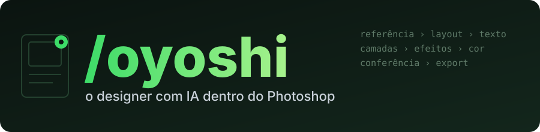
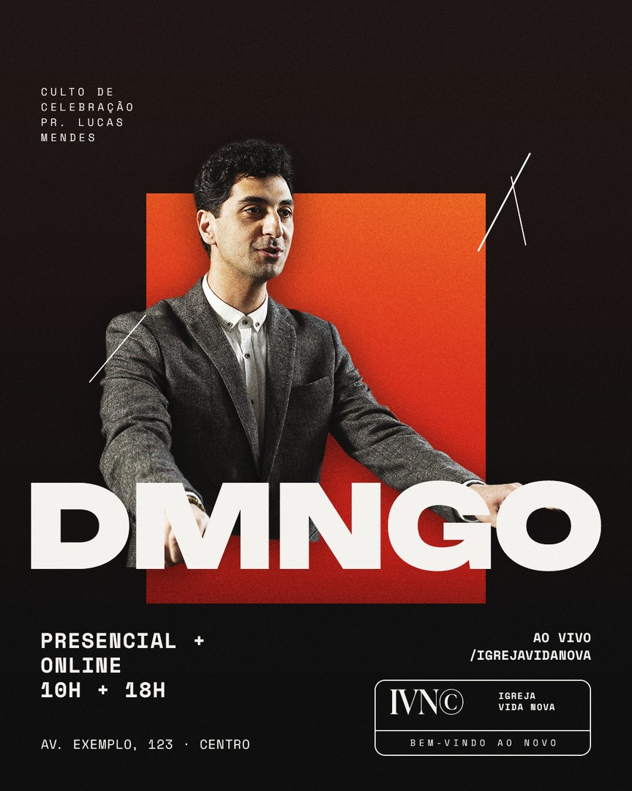
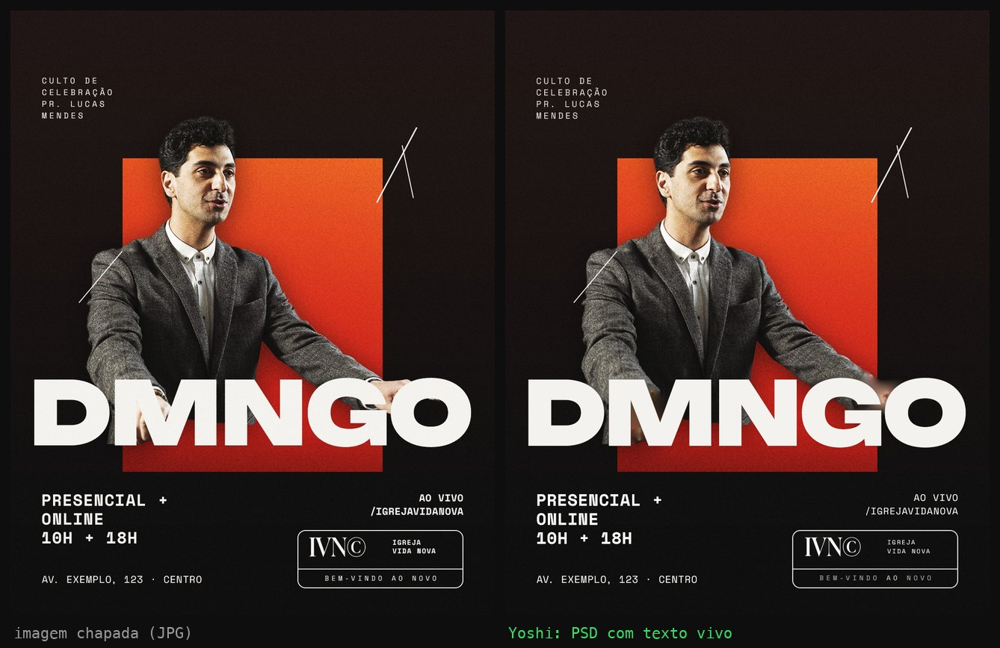
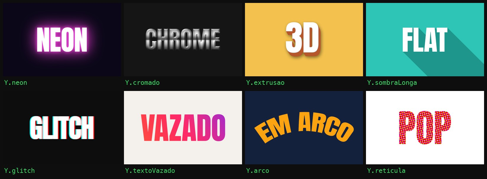

<div align="center">

[](#readme)

[](https://github.com/gabrielxreis/oyoshi/commits/main "Histórico")
[](https://claude.com/claude-code "Claude Code")
[](#requisitos "Requisitos")
[](#canva "Canva")
[](#requisitos "Requisitos")
[](#requisitos "Requisitos")
[](LICENSE "Licença")

</div>

**/oyoshi** (o Yoshi) é uma skill do Claude Code que faz design **dentro do Adobe Photoshop** a partir das suas referências: post, carrossel, story, capa e miniatura do YouTube, anúncio, banner, mockup, recorte e tratamento de foto. Tudo sai em **camadas editáveis** (texto com a fonte de verdade, formas vetoriais, smart objects, estilos e camadas de ajuste), conferido olhando a imagem exportada. É o irmão de design do [**/ogab**](https://github.com/gabrielxreis/ogab), o editor de vídeo.

> **Fase atual: engenharia reversa concluída, fluxo de design em construção.** O mapa do que o Photoshop faz por script está pronto e testado; a ponte já cria documentos, textos, formas, efeitos e camadas de ajuste. O passo a passo "referência > layout > aprovação > montagem" vem nas próximas versões.

* [INSTALAÇÃO](#instalacao)
    * [Requisitos](#requisitos)
* [COMO O YOSHI CONTROLA O PHOTOSHOP](#como-o-yoshi-controla-o-photoshop)
* [O QUE JÁ FUNCIONA](#o-que-ja-funciona)
* [PRESETS DE ESTILO](#presets-de-estilo)
* [CRÉDITOS GENERATIVOS](#creditos-generativos)
* [GRAVADOR DE AÇÕES](#gravador-de-acoes)
* [CANVA](#canva)
* [ARMADILHAS CONHECIDAS](#armadilhas-conhecidas)
* [ESTRUTURA DO REPOSITÓRIO](#estrutura-do-repositorio)
* [LICENÇA](#licenca)


# INSTALAÇÃO

```bash
git clone https://github.com/gabrielxreis/oyoshi.git ~/.claude/skills/oyoshi
```

Com o Photoshop aberto, gere o catálogo da sua máquina (uma vez, e de novo quando o Photoshop atualizar):

```bash
python3 ~/.claude/skills/oyoshi/scripts/sondar/catalogar.py
```

Depois é só pedir no Claude Code: `/oyoshi faz um carrossel de 5 slides com essa referência`.

O Yoshi se atualiza sozinho (`git pull`) toda vez que é usado.

## Requisitos

| O quê | Por quê |
|---|---|
| macOS | A ponte usa AppleScript (`do javascript`). Windows (COM) está nos planos. |
| Adobe Photoshop 2026 (27.x) | As ferramentas nativas do agente só existem no 2026. O básico (ExtendScript) funciona em versões antigas. |
| Python 3.10+ | `scripts/ps_lib.py`. Sem dependências externas. |
| Permissão de Acessibilidade para o Terminal | Só para fechar alertas do Photoshop sozinho (System Events). |

Não precisa instalar plugin, abrir porta nem configurar senha no Photoshop.


# COMO O YOSHI CONTROLA O PHOTOSHOP

Engenharia reversa completa em [`docs/photoshop_api.md`](docs/photoshop_api.md). Resumo:

| Camada | O que é |
|---|---|
| **Agente nativo do Photoshop** | O Photoshop 2026 traz um "MCP interno" (o motor do Assistente de IA): **137 ferramentas com JSON Schema** + 18 escondidas, chamadas pelo Action Manager (`listTools` / `executeTool`). Validam parâmetros e respondem em JSON. |
| **ExtendScript + Action Manager** | DOM clássico (33 classes reflexionadas, índice completo de 93 classes e 725 enums) e qualquer evento que o Photoshop grava: smart objects, estilos de camada, formas, IA local. |
| **Comandos dos painéis da Adobe** | 257 comandos batchPlay extraídos do JavaScript dos 23 painéis internos do próprio Photoshop (Neural Filters, troca de céu, exportar sem diálogo...). |
| **Menu pela tela** | 759 comandos de menu catalogados com o ID, para o raro caso sem script. |

```python
import sys, os; sys.path.insert(0, os.path.expanduser("~/.claude/skills/oyoshi/scripts")); import ps_lib as PS
d = PS.doc_frente()
PS.ferramenta("document_create_text_layer", {"doc_id": d, "text": "TÍTULO", "font_postscript_name": "Montserrat-Bold",
    "font_size": {"value": 96, "unit": "pixels"}, "position_x": 50, "position_y": 20, "position": "top"})
PS.js("app.activeDocument.layers.length")
```


# O QUE JÁ FUNCIONA

**Arte completa em camadas em 10-20 segundos.** O Yoshi escreve a peça como um roteiro (`arte.jsx`) usando a biblioteca `yoshi.jsx` (grupos, cor, degradê, foto ajustada à caixa, recorte de pessoa com IA local, texto com trechos coloridos, formas, efeitos, grão) e o `montar.py` constrói o PSD e o PNG. Exemplo: [`presets/igreja-moderna/exemplo`](presets/igreja-moderna/exemplo).




Testado no Photoshop 2026 (27.11), Mac:

- Documento novo, pranchetas (carrossel num PSD só), grupos, máscaras de corte.
- **Texto** com fonte por PostScript name, cor, alinhamento, caixa de parágrafo e texto que se ajusta sozinho ao bloco.
- **Smart object:** colocar imagem e **trocar o conteúdo** (base de template e mockup).
- Formas vetoriais com canto arredondado, cor sólida, degradê, **estilos de camada** (sombra, traço).
- **14 tipos de camada de ajuste** com parâmetros e 36 presets de cor prontos.
- **Selecionar assunto e remover fundo** (IA local, sem crédito).
- Ler a estrutura inteira do documento (camadas, tipo, posição, máscara, bloqueio) em milissegundos.
- 7 conjuntos de Ações da Adobe já instalados: redimensionar para Instagram/Facebook/X/miniatura do YouTube, desfocar fundo, grades de composição, exportar.
- Exportar PNG, JPG e PSD em camadas, e conferir olhando a imagem.


# DA REFERÊNCIA AO PSD IDÊNTICO

O Yoshi foi treinado remontando posts reais pixel a pixel. As ferramentas que saíram disso:



*À esquerda, o JPG achatado. À direita, o PSD que o Yoshi reconstruiu sozinho: fundo limpo, 9 camadas de texto vivo com a fonte reconhecida (Unbounded, Space Mono, Ivy Presto) e posição conferida em até 1 px. Único ajuste manual: `--corrigir "/ IGREJA=/IGREJA;•=·;IVNC=IVN©"` para três erros de leitura do OCR. Limite visível: a ponta dos dedos sobre o "G" ficou borrada pelo preenchimento do fundo.*

- **Imagem chapada -> PSD editável** (`reconstruir.py`): OCR nativo do macOS acha cada linha e palavra; o fundo vira "fundo limpo" (texto apagado com preenchimento sensível ao conteúdo, sem crédito); cada linha volta como texto vivo com a fonte reconhecida, negrito e cor de destaque detectados por palavra, caixa marca-texto como forma editável, interface do Instagram (seta, bolinhas) removida.
- **Ciclo idêntico** (`ciclo.py`): mede a referência, monta, mede o próprio resultado com a mesma régua e corrige até o erro ficar em 1 px.
- **Reconhecer a fonte** em quatro camadas: Localizar fonte semelhante da Adobe, comparador local (desenho + espessura + largura), prova de fogo no Photoshop (`provar_fontes.py`) e WhatTheFont.
- **Medir** texto (caixa, altura de maiúscula, altura-x, cor real), objeto (seleção por IA, ângulo e bordas de objeto reto), paleta 60/30/10 e grade de alinhamento da referência.
- **Template da marca** (`virar_template.py`): o post reconstruído vira molde; texto novo com `**negrito**` e `{{destaque}}`, série inteira com `lote.py`.
- **Produção**: versão story automática (`para_story.jsx`), carrossel em pranchetas, mockup em perspectiva exata, QA automático de contraste/zona segura/margens (`conferir_arte.py`).
- **Efeitos**: neon, cromado, extrusão 3D, sombra longa, texto vazado, retícula, dupla exposição, luz de recorte, sombra de contato, glitch RGB, LUT de cinema, mapa de deslocamento, texto em arco, Mesclar se, separação de frequência (detalhes em `docs/tecnicas.md`).



*Cada quadro é uma linha de `yoshi.jsx` sobre um texto vivo (continua editável no Photoshop). Gerado por script, sem IA e sem crédito.*

# PRESETS DE ESTILO

O Yoshi aprende um estilo dissecando PSDs profissionais (ou fazendo engenharia reversa de posts publicados) e guarda as **técnicas** como preset: árvore de camadas, tipografia (com alternativa gratuita), paletas, mesclagens e uma receita passo a passo. Nenhum arquivo de terceiros entra no repositório.

| Preset | O que é |
|---|---|
| [`igreja-culto`](presets/igreja-culto/README.md) | Flyer gospel: palco escuro, feixes de luz, cantor recortado e iluminado pela cor do palco, título com duas fontes na mesma palavra, anéis feitos com a letra "O", créditos em linha. Variação colagem. |
| [`igreja-moderna`](presets/igreja-moderna/README.md) | Editorial de rede de igrejas: "DMNGO" gigante, pregador saindo da moldura, colagem maximalista, fonte mono de serviço, rabiscos à mão, line-up em pirâmide, raios de cor. 5 arquétipos. |

Presets **por marca** (cores, fontes, árvore e regras de um cliente) ficam na pasta do cliente, fora do git.

# CRÉDITOS GENERATIVOS

Estas ferramentas usam o Firefly e **gastam créditos generativos da sua conta Adobe**. O Yoshi só usa com sua autorização na hora:

| Ferramenta | Modelo |
|---|---|
| Preenchimento generativo | Firefly Image 5 |
| Texto para imagem | Nano Banana 3 (via Firefly) |
| Expansão generativa | Firefly Image 4 |
| Upscale, nitidez e redução de ruído | Topaz (via Firefly) |
| Harmonizar | Firefly |


# GRAVADOR DE AÇÕES

O Yoshi aprende olhando: com o gravador ligado, cada ação que **você** faz no Photoshop (menu, painel, atalho) vira uma linha com o comando e todos os parâmetros. Você faz uma vez, ele repete por script.

```python
PS.gravar(True)    # você faz a ação no Photoshop
PS.gravar(False)   # o resultado fica em $TMPDIR/oyoshi_gravacao.jsonl
```


# CANVA

O Canva não tem app local para controlar. O caminho é o **conector oficial do Canva** (MCP), que gera, busca, exporta e edita designs por transação (troca texto, imagem e título). Entra como segundo editor quando o fluxo de design do Photoshop estiver pronto.


# ARMADILHAS CONHECIDAS

- `app.runMenuItem` não funciona quando o script vem do AppleScript. Usar o comando do Action Manager equivalente.
- Menu pela tela só funciona com o Photoshop **na frente**; em segundo plano os itens aparecem desabilitados.
- Algumas ações abrem **alerta modal** que trava o Photoshop. A `ps_lib` fecha sozinha e guarda a mensagem em `PS.ALERTAS`.
- Nas ferramentas nativas, a posição do texto é em **% do documento** e o ID do documento é um UUID (não o número do DOM).
- A fonte vai pelo PostScript name (`Montserrat-Bold`), não pelo nome que aparece no menu.


# ESTRUTURA DO REPOSITÓRIO

```
SKILL.md                     instruções do Yoshi para o Claude
docs/photoshop_api.md        engenharia reversa: o que dá para fazer e como
docs/catalogo/               menus, DOM, vocabulário do Action Manager, testes
docs/catalogo/local/         gerado na sua máquina pelo catalogar.py (fora do git)
scripts/ps_lib.py            ponte Python com o Photoshop
scripts/jsx/                 bibliotecas ExtendScript (descritor para JSON, agente, gravador)
scripts/sondar/              scripts de sondagem para refazer a engenharia reversa
scripts/dissecar_psd.py      estuda um PSD sem abrir o Photoshop
scripts/jsx/yoshi.jsx        biblioteca de montagem (Y.texto, Y.colocar, Y.recortar...)
scripts/montar.py            roda um arte.jsx e gera PSD + PNG
scripts/extrair_so.py        tira fotos e logos de dentro dos smart objects de um PSD
presets/<estilo>/            técnicas de um estilo (README + preset.json)
```


# LICENÇA

MIT. O índice do DOM em `docs/catalogo/flue_api-index.txt` vem do projeto [sfkislev/flue](https://github.com/sfkislev/flue) (MIT). Photoshop e Firefly são marcas da Adobe; este projeto não tem ligação com a Adobe.
